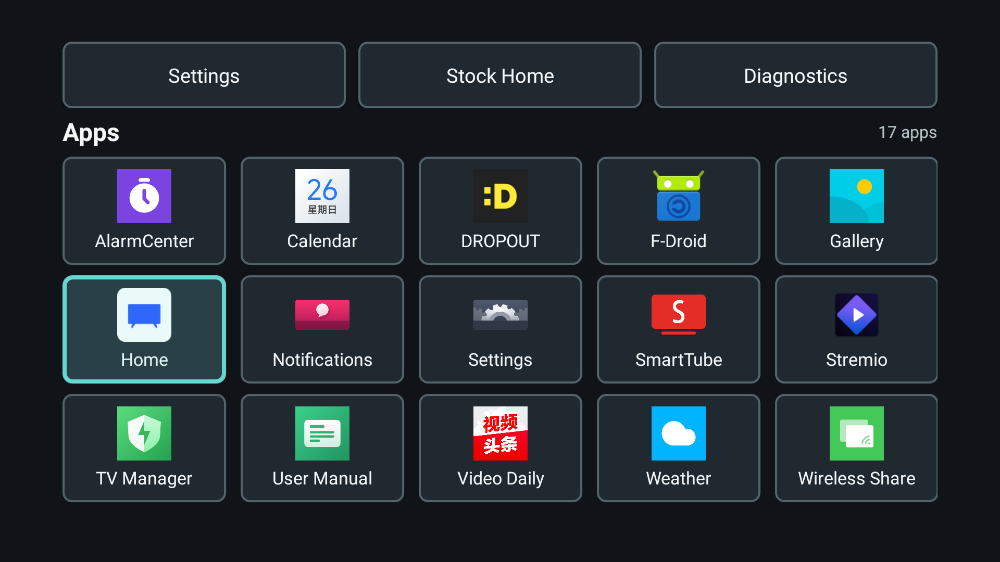
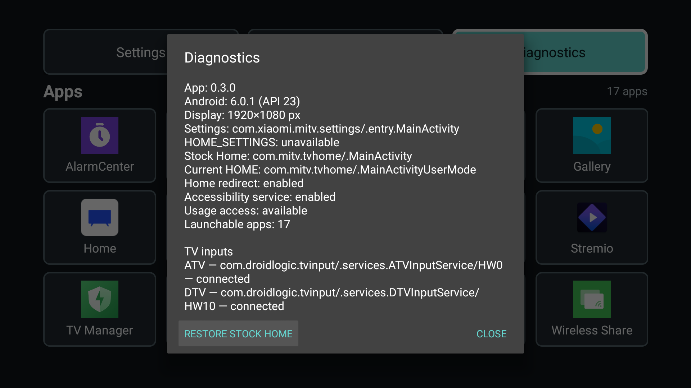
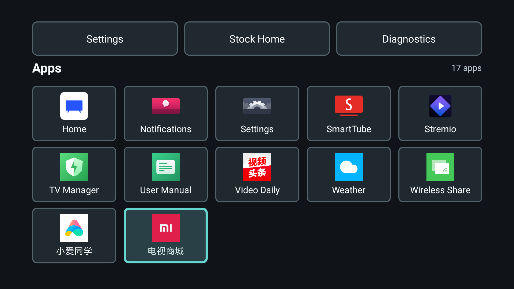
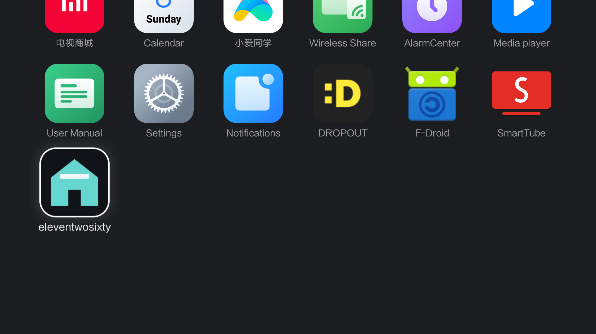

# eleventwosixty

A minimal, offline Android TV launcher for the Xiaomi MiTV4-ANSM0 (Android 6.0.1/API 23, ARM32 userspace, 1920×1080 composition). It redirects Xiaomi's physical Home path without replacing firmware, disabling Xiaomi packages, or registering as Android's preferred HOME app.

## Screenshots

| Home | Diagnostics |
| --- | --- |
|  |  |



The same APK is also visible in PatchWall's own app list:



## Design

- Plain Kotlin and platform Android Views; no AndroidX, Compose, WebView, Google services, native code, backend, or network access.
- Permanent, independently resolved **Settings**, explicit **Stock Home** (`com.mitv.tvhome/.MainActivity`), and **Diagnostics** actions.
- One alphabetical tile per enabled launchable package. `LEANBACK_LAUNCHER` wins over `LAUNCHER`; every launch uses the resolved explicit component.
- D-pad GridView navigation with a high-contrast focus selector. The last focused app component is the only launcher selection persisted.
- `MainActivity` is an independent `MAIN` activity advertised under both `LEANBACK_LAUNCHER` and `LAUNCHER`, so it appears in PatchWall's Android 6 app list. There is no HOME alias or preferred-HOME manipulation because Xiaomi's Home-key path ignores it on this model.
- A minimal, system-bound accessibility service polls usage events once per second only while the display is interactive and the local redirect is enabled. It redirects only when the newest foreground event is exactly `com.mitv.tvhome/.MainActivityUserMode`.
- Diagnostics report app/Android/display details, utility resolution, app and TV-input information, and the separate redirect, accessibility-service, and usage-access states.
- App icons use a 48-entry in-memory LRU only. Missing capabilities and launch failures remain visible instead of crashing.

## Privacy and permissions

The APK requests exactly `android.permission.PACKAGE_USAGE_STATS`. It requests no Internet, network-state, boot, overlay, input, identifier, storage, microphone, location, or secure-settings permission.

The accessibility service is protected by `android.permission.BIND_ACCESSIBILITY_SERVICE`. It cannot retrieve window content, does not filter or intercept keys, does not inspect text or views, and never performs global accessibility actions. PatchWall emits no useful accessibility window event on the target Android 6 firmware, so the service uses accessibility only for system-managed lifecycle and polls `UsageEvents` while active. It examines only foreground package name, activity class, and event timestamp in memory. It stores no usage history. Private preferences contain only the local enable/suppression state and bounded redirect-attempt timestamps used by the crash circuit breaker.

The service is dormant when redirect is locally disabled or the display is not interactive. Three launcher attempts that fail before the launcher window gains focus within the bounded window disable redirect and open Stock Home.

## Build and checks

The flake is pinned and supports `aarch64-darwin` without a nix-darwin rebuild. It provides JDK 17, Android platform/build tools 35, platform tools, an ARM64 system image, and the emulator.

```sh
nix develop 'path:.'
./gradlew clean testDebugUnitTest lint assembleDebug
```

The debug APK is `app/build/outputs/apk/debug/app-debug.apk`.

Inspect the artifact without installing it:

```sh
apkanalyzer manifest print app/build/outputs/apk/debug/app-debug.apk
apkanalyzer apk summary app/build/outputs/apk/debug/app-debug.apk
wc -c app/build/outputs/apk/debug/app-debug.apk
```

## Optional headless emulator

Create the AVD once, then run it without opening a GUI:

```sh
nix develop 'path:.'
avdmanager create avd --force --name eleventwosixty-api35 \
  --package 'system-images;android-35;default;arm64-v8a'
emulator @eleventwosixty-api35 -no-window -no-audio -no-boot-anim \
  -no-snapshot -wipe-data -gpu swiftshader_indirect -skin 1920x1080
```

In a second shell, wait for boot and run only against that emulator:

```sh
adb -e wait-for-device
adb -e shell 'while [ "$(getprop sys.boot_completed)" != 1 ]; do sleep 1; done'
./gradlew connectedDebugAndroidTest
```

The emulator can check private preference behavior and service binding lifecycle, but it does not reproduce Xiaomi PatchWall or prove physical Home-key behavior.

## Setup, local restore, and removal

Install the APK, then run the setup script with an explicit ADB device serial or `host:port`; it refuses to use an implicit/default device:

```sh
adb -s DEVICE_SERIAL install -r app/build/outputs/apk/debug/app-debug.apk
./scripts/home-redirect.sh DEVICE_SERIAL enable
```

The setup command grants only the `GET_USAGE_STATS` app-op, appends this service to `enabled_accessibility_services` without deleting existing entries, and enables accessibility. Run it again after replacing the APK because Android may unbind an accessibility service during an update. Then open **eleventwosixty → Diagnostics → Enable Home redirect**. Diagnostics reports whether both system prerequisites are available.

On tested Android 6 firmware, forcibly killing the accessibility-service process removes its live binding even though the secure setting remains present. Normal standby/wake retains the binding, but recovery from a forced service crash requires running the disable and enable setup commands again.

Pressing Home briefly shows PatchWall before eleventwosixty returns. On tested build 3386, Android holds the background activity launch for about five seconds after Home; this delay is expected.

**Restore Stock Home** in Diagnostics disables only the private redirect preference, adds a two-minute local suppression window, and explicitly opens Stock Home. The top-row **Stock Home** utility uses the same suppression window without disabling future redirects. Returning to eleventwosixty clears suppression immediately. The accessibility service can remain registered but dormant.

To remove the system prerequisites without disturbing other accessibility services:

```sh
./scripts/home-redirect.sh DEVICE_SERIAL disable
```

That command removes only this service from the colon-separated accessibility list and resets only this app's `GET_USAGE_STATS` app-op. If no accessibility services remain, it disables the global accessibility switch. For full removal, run the disable command first and then uninstall `sh.rrvsh.eleventwosixty`. Every Xiaomi package remains installed and enabled throughout.

## On-device validation

Validated on a Xiaomi MiTV4-ANSM0 running Android 6.0.1 build 3386:

- D-pad navigation, safe-margin three-row layout, Settings fallback, Diagnostics, Stock Home and ordinary app launch
- discovery and launch from PatchWall's own app list
- Home-key redirect through the TV's Android input path from the launcher, Calendar, Xiaomi Settings and the Xiaomi screensaver
- repeated Home presses without triggering the crash circuit breaker
- two-minute Stock Home suppression, local restore and re-enable
- accessibility-service retention across standby/wake, plus explicit recovery after a forced process kill
- final ten-minute interactive idle measurement: approximately 0.10% CPU and 28.6 MiB total PSS
- no `INTERNET` permission or Linux `inet` group

A final full-reboot check remains necessary because this TV disables network ADB at boot.

## License

Apache-2.0; see [LICENSE](LICENSE).
